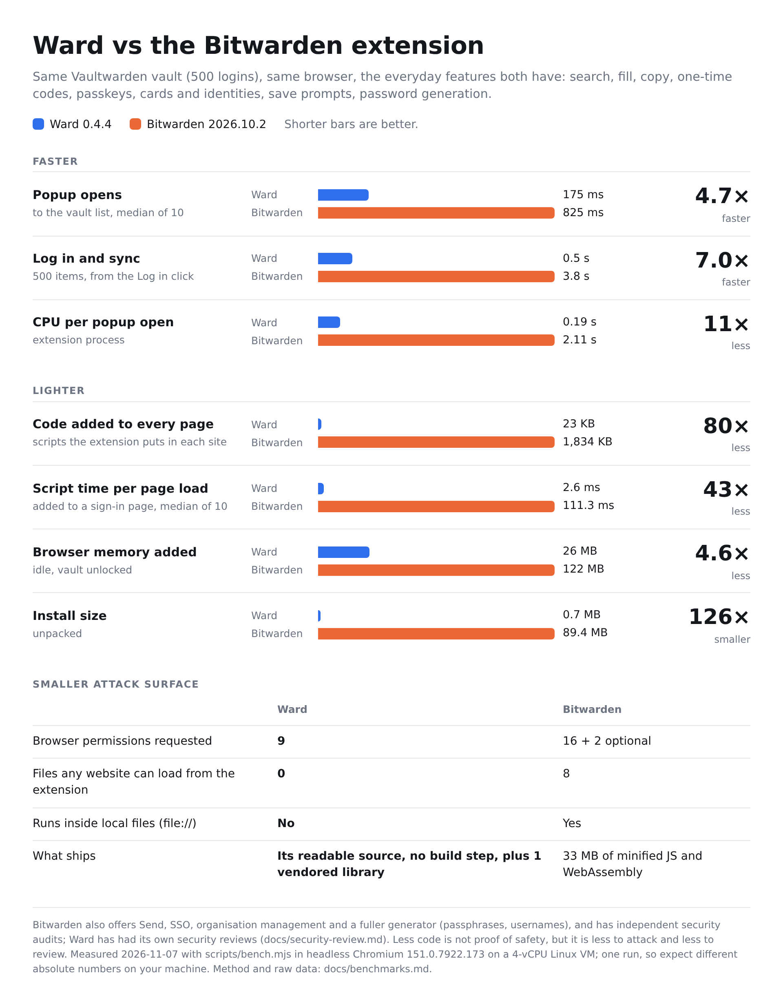
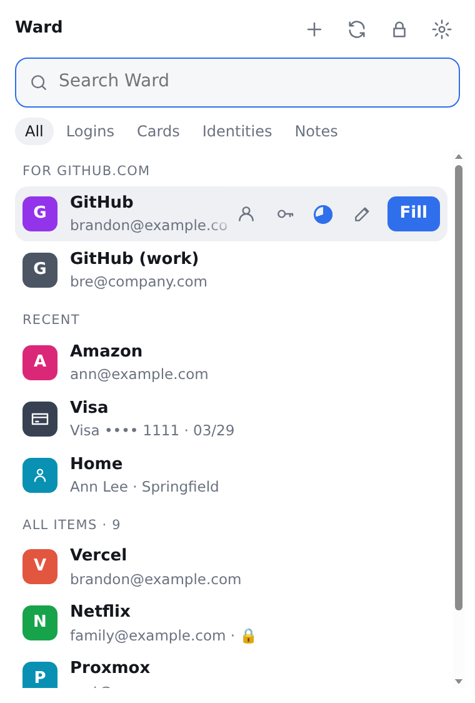
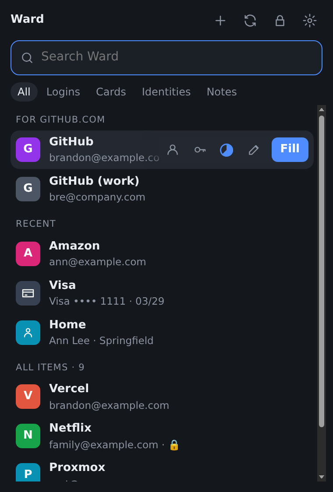
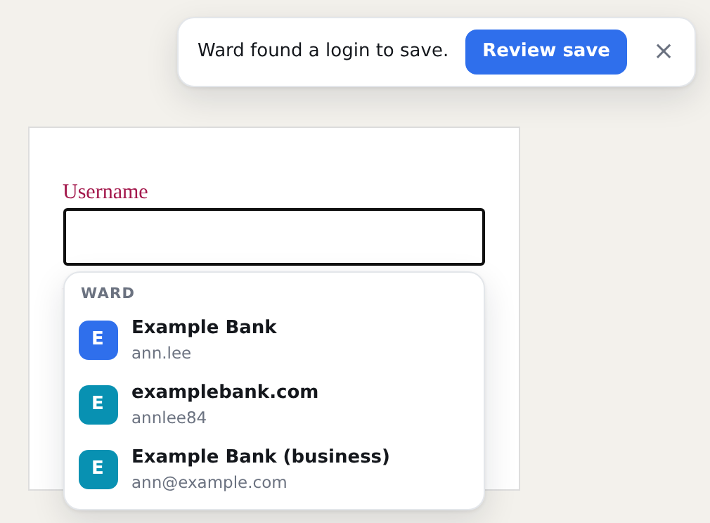
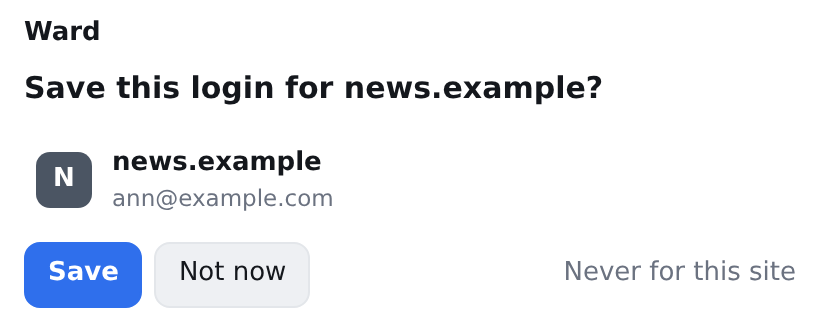

# Ward

A fast, lean browser extension for a self-hosted [Vaultwarden](https://github.com/dani-garcia/vaultwarden)
(or any Bitwarden-compatible) server. The goal is 1Password-style speed and polish on a server you own:
instant search and fill, offline use, Touch ID unlock, and live sync.

Ward is plain JavaScript with no framework, no bundler and no npm dependencies. The files in this repository
are exactly what the browser runs, so a release can be reviewed line by line.

Developed and tested on **Vivaldi on macOS**; any Chromium browser (121 or newer) should work. Firefox is not a
target yet.

## How it compares

<picture>
<source media="(prefers-color-scheme: dark)" srcset="docs/ward-vs-bitwarden-dark.png">

</picture>

Same machine, same vault, the everyday features both have. Bitwarden does more (Send, SSO, organisations, a fuller
generator) and has independent audits, so this isn't a like-for-like feature comparison. Method, caveats and the
numbers as tables: [docs/benchmarks.md](docs/benchmarks.md).

## Screenshots

<p>


</p>
<p>


</p>

Screenshots use sample data (`node scripts/screenshots.mjs`).

## Status

Early release (0.4.x), not yet widely tested. See [ROADMAP.md](ROADMAP.md) for what's
done and next, [Known limitations](#known-limitations) below, and [docs/security-review.md](docs/security-review.md)
for the security reviews.

## Install (unpacked)

1. Clone this repository (or download and unzip a release) somewhere permanent.
2. Open `vivaldi://extensions` (or `chrome://extensions`) and turn on **Developer mode**.
3. Click **Load unpacked** and pick the repository folder (the one that contains `manifest.json`).

The unpacked extension ID is always `nnejaecbmnadljdpinaljbdpfcoocain` (pinned by `key` in `manifest.json`).
Loading from a specific commit means nothing changes until you pull and reload on purpose.

## What it does today

- One list for every type: this site's logins first, then recent items, then everything (filter chips: All, Logins,
  Cards, Identities, Notes). The selected row (this site's best match when Ward opens; any row you click) keeps its
  one-click actions visible; other rows show them on hover: copy username, password, one-time code (a pie that
  empties as the code runs out), card number and security code, email, plus Fill where it can fill. Clicking a row only selects it.
- Right-click a field on a page: Ward > a login for this site > Fill / Copy username / password / one-time code.
- Copied passwords, codes and card details are cleared from the clipboard after 30 s (setting).
- Settings: Account (log out per vault), saving offers, copying, locking, Touch ID, appearance (follows the system).

- Logins: search, fill (popup, in-page menu under the login field, Cmd+Shift+L), copy, add, edit, delete
- TOTP codes, passkeys (stored in Bitwarden's format, so the official apps can use them), save/update prompts
- Several vaults in one list (Vaultwarden, bitwarden.com, bitwarden.eu)
- Offline: unlock and fill from an encrypted local copy; syncs when the popup opens (if older than 5 minutes)
- Matching follows Bitwarden's per-URL match setting and equivalent domains, with the Public Suffix List
- Cards, identities and secure notes: browse, search, add, edit, copy; **Fill** puts a card or identity into a
  checkout or address form (https pages only). Cards may fill the site's own frames and known payment-provider
  frames (Stripe, Braintree, Adyen, PayPal, Square, Shopify and others); identities the site's own frames only.
  The form filler (`formfill.js`) is injected only when you press Fill.
- Saving cards and addresses: after you submit a checkout or address form, Ward offers to save a card or address
  you typed that isn't in the vault yet (review window with checkboxes; the security code only if you tick it).
  Only values you typed count (a page can't plant them), https pages only, card fields from the site or known
  payment-provider frames, drafts kept in memory-only session storage. **from page** on the Cards/Identities tab
  reads the current form into a new item for you to review.
- Settings (popup footer): turn login offers and card/address offers on or off (off: card/address fields aren't
  watched at all), edit the never-offer site list, auto-lock, Never lock, Touch ID.

## Security model

The master password never leaves the popup. Unlock happens locally against the protected key saved at login.
The vault key and decrypted list live in the browser's memory-only session storage and are gone when you lock or
quit the browser. "Never lock" keeps the key on disk instead (like Bitwarden's Never timeout). Cached vault data on
disk is encrypted. Nothing is filled without a click or the shortcut.

### Known limitations

These are open findings from [docs/security-review.md](docs/security-review.md); read them before trusting Ward with
a real vault.

- **The server is trusted for matching (M4).** A hostile or compromised server can change equivalent domains or a
  login's match type so that Ward offers a real password on another site. The encryption is not broken by this;
  only use Ward with a server you run or trust.
- **"Never lock" stores the raw vault key on disk (M6)**, like Bitwarden's "Never" timeout. Anyone who can read your
  browser profile can then decrypt the vault. It is off by default.
- **Touch ID unlock is experimental.** It relies on the WebAuthn PRF extension (see Settings > Touch ID). It has
  been tested on macOS only; Windows Hello should work on recent Windows 11 and Chrome versions but is untested.
- Smaller open items (regex match types, passkey prompts, Firefox) are listed in the review.

CI enforces guard rails on every change, including upstream cherry-picks: manifest permissions are pinned,
network calls may only go to the configured server (plus well-known passkey endpoints), dynamic code is
forbidden, vendored files must match pinned hashes, and per-page code stays inside a size budget.
See `scripts/guard.mjs`.

## Development

```sh
node test.mjs                       # offline checks
docker run -d --name ward-vw -p 127.0.0.1:8099:80 -e I_REALLY_WANT_VOLATILE_STORAGE=true \
  -e LOGIN_RATELIMIT_MAX_BURST=100 -e LOGIN_RATELIMIT_SECONDS=1 vaultwarden/server:1.37.5
node test.mjs --integration         # against the disposable Vaultwarden above
node scripts/guard.mjs              # security guard rails
./pack.sh                           # dist/ward-<version>.zip
node scripts/screenshots.mjs        # docs/screenshots/ from the sample-data previews (needs Chromium)
node scripts/bench.mjs --bitwarden <dir>   # speed/memory/CPU vs Bitwarden, see docs/benchmarks.md
```

UI preview: `node scripts/preview.mjs` writes `preview/ward-popup.html` (git-ignored), the real popup with sample data
in one self-contained file, and `preview/ward-inpage.html`, a sample sign-in page with the real in-page menu and save
bar (click a field). Open it in any browser or a sandboxed HTML preview panel. Rerun it after each UI change.
Only that generated copy fakes the extension APIs and drops the popup's refusal to run in a frame.

## Upstream

Ward is built on [BW Lite](https://github.com/yowmamasita/bw-lite) by Ben Adrian Sarmiento (MIT), seeded from
commit `1d77b9e`. The git remote `upstream` points there (push disabled). A weekly workflow reports new upstream
commits; fixes are cherry-picked on purpose and go through the same CI guards. Small fixes that fit BW Lite's
scope are offered back upstream.

Internal message keys still use the `bwlite` prefix so upstream fixes cherry-pick cleanly.

Not affiliated with Bitwarden, Inc. or the Vaultwarden project. MIT licensed. `vendor/argon2.umd.min.js` is
[hash-wasm](https://github.com/Daninet/hash-wasm) 4.12.0 (MIT). `vendor/public_suffix_list.*` is the
[Public Suffix List](https://publicsuffix.org/list/) (MPL 2.0).
